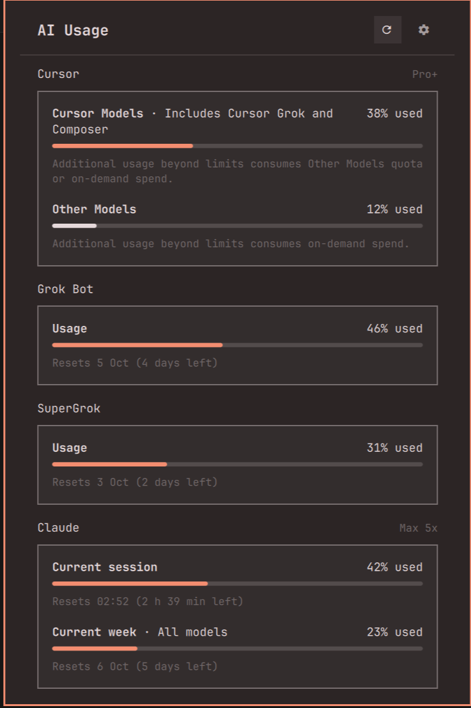

# AI Usage

Plan limits for Cursor, Grok Bot, SuperGrok, and Claude in one Omarchy bar panel: how much of each allowance you have used, when it resets, and which plan you are on.



Plugin id: `io.github.hurlydesousa.ai-usage`

## Install

```sh
omarchy plugin add https://github.com/HurlyDesousa/omarchy-ai-usage.git --enable
```

Place it on the bar if needed:

```sh
omarchy bar move io.github.hurlydesousa.ai-usage --section right
```

## Usage

Click the `󰚩` icon to open the panel; Escape closes it. The refresh button fetches fresh numbers. While the panel is open it refreshes every five minutes, and opening it refreshes anything older than that.

Each section reads a sign-in that is already on this machine. A section whose app is not signed in says what to run instead of showing bars.

| Section | Needs | Reads | Asks |
|---|---|---|---|
| Cursor | Cursor, signed in | Cursor's session token from its `state.vscdb` | Cursor's usage dashboard (`api2.cursor.sh`) |
| Grok Bot | Cursor, signed in | the same Cursor token | Cursor's usage dashboard, weekly Grok Bot allowance |
| SuperGrok | the grok CLI after `grok login` | `~/.grok/auth.json` and local grok session logs | grok's billing endpoints (`cli-chat-proxy.grok.com`, `grok.com`) |
| Claude | Claude Code after `claude auth login`, Pro or Max plan | Omarchy's `omarchy-agent-usage-claude` collector, which reads `~/.claude/.credentials.json` | Anthropic's usage endpoint |

Tokens only go to the service that issued them. Nothing is sent anywhere else.

## Renewing a lapsed sign-in (opt-in)

Claude Code and the grok CLI renew their saved sign-ins only while they run, so a panel that just watches usage finds them expired within hours and stops updating. When that happens the section says how old its numbers are and offers **Renew this sign-in automatically**.

Pressing it is your consent for AI Usage to renew that sign-in the way the app itself does (Claude: `platform.claude.com`; grok: `auth.x.ai`) and to write the result back to the app's own credential file, `~/.claude/.credentials.json` or `~/.grok/auth.json`. The file is replaced atomically and kept owner-only, and a newer sign-in the app saved in the meantime is never overwritten. Nothing is written before you press the button.

Turn renewal off again (or on, without the button):

```sh
~/.config/omarchy/plugins/io.github.hurlydesousa.ai-usage/omarchy-ai-usage consent claude off
~/.config/omarchy/plugins/io.github.hurlydesousa.ai-usage/omarchy-ai-usage consent grok off
```

## Settings

Optional keys on the widget's entry in `bar.layout` in `~/.config/omarchy/shell.json`:

| Key | Default | Effect |
|---|---|---|
| `showCursor`, `showGrokBot`, `showSuperGrok`, `showClaude` | `true` | Hide a section you do not use |
| `cursorLabel`, `grokBotLabel`, `superGrokLabel`, `claudeLabel` | your plan | Text to the right of a section title |
| `footerTitle`, `footerDetail`, `footerLabel` | none | A note row under the sections |

```json
{ "id": "io.github.hurlydesousa.ai-usage", "showGrokBot": false, "claudeLabel": "Opus" }
```

## Dependencies

- Python 3 (standard library only); the panel runs the bundled `omarchy-ai-usage` script
- Omarchy's stock `omarchy-agent-usage-claude` collector, for the Claude section
- Whichever of Cursor, the grok CLI, and Claude Code you want to see

## Files it writes

- `~/.local/state/omarchy/agents/usage/cursor.json`, `grokbot.json`, `grok.json`, and `claude.json`: usage snapshots. Omarchy's own agents panel writes `claude.json` too.
- `~/.local/state/omarchy/ai-usage/consent.json`: your renewal choices
- Only after you allow renewal: that app's credential file, as described above

## Remove

```sh
omarchy plugin remove io.github.hurlydesousa.ai-usage
```

That removes the plugin files. To drop its state as well:

```sh
rm -f ~/.local/state/omarchy/agents/usage/{cursor,grokbot,grok}.json
rm -rf ~/.local/state/omarchy/ai-usage
```

Leave `claude.json` if you use Omarchy's agents panel; it reads the same file.

## License

MIT. See [LICENSE](LICENSE).
